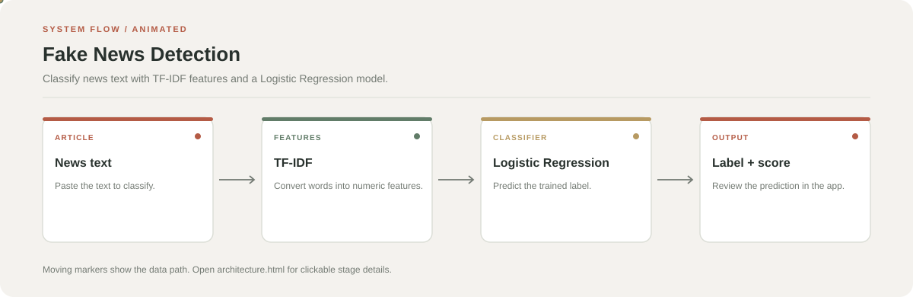

# Fake News Detection

**A lightweight news-text classifier built with scikit-learn and Streamlit.**

The app transforms article text with TF-IDF and predicts a real/fake label with a Logistic Regression classifier trained from `True.csv` and `Fake.csv`.

**Stack:** Python, Pandas, scikit-learn, TF-IDF, Streamlit



## Features

- Predicts a label for pasted news text.
- Displays a confidence score from the classifier.
- Trains a model when a saved `model.pkl` is not available.
- Reuses the saved model on later runs.

## Data and workflow

1. Read the labelled `True.csv` and `Fake.csv` datasets.
2. Prepare text and convert it into TF-IDF features.
3. Train or load the Logistic Regression classifier.
4. Return the predicted class and confidence to the interface.

## Run locally

```bash
git clone https://github.com/chyk2468/Fake-News-Detection.git
cd Fake-News-Detection
python -m venv .venv
```

Activate the environment and install the project dependencies:

```bash
pip install -r requirements.txt
streamlit run app.py
```

## Repository map

| File | Purpose |
| --- | --- |
| `app.py` | Streamlit application |
| `Fake.csv` | Dataset rows labelled fake |
| `True.csv` | Dataset rows labelled real |
| `requirements.txt` | Python dependencies |

## Important limitation

The output reflects patterns learned from the training data. It does not prove that an article is true or false. Check the original reporting and trusted sources before drawing conclusions.
